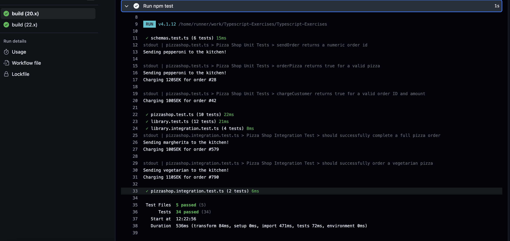
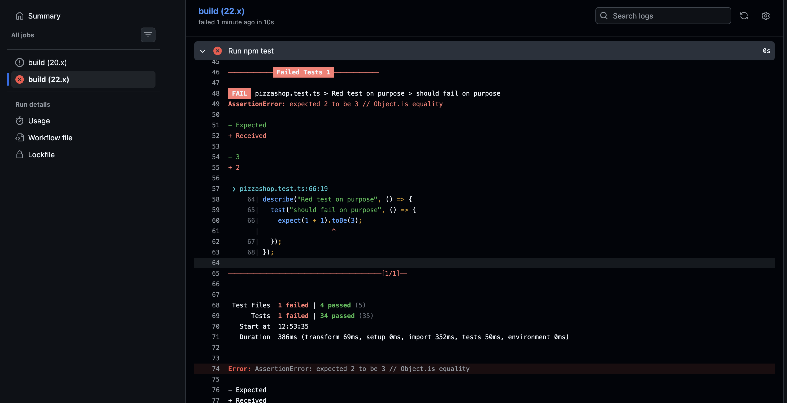
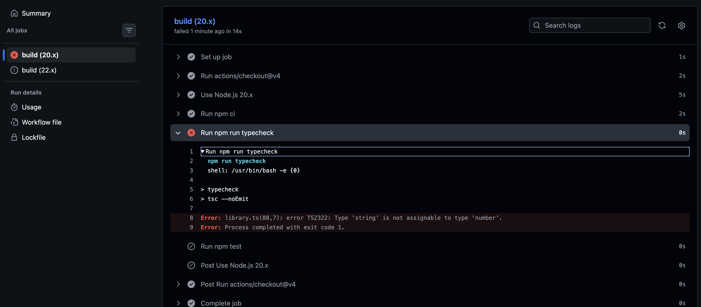
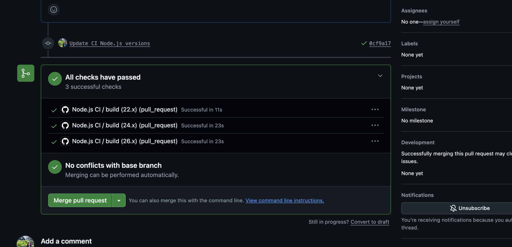

# Excersice 1 

question 03 -  Eventhough vegetarian pizza type was accepted by PizzaTypeSchema, but the menu did not contain a price for vegetarian pizza. As a result, menu[pizzaType] returned undefined.
The red line shows a TypeScript error. TypeScript checks types, while Zod checks data when the code runs. Vitest can still run tests without checking all TypeScript types. 

question 05 - pizzashop.integration.test.ts why?? Because orderPizza("vegetarian") tests the ordering process, which may involve orderPizza(), createPizza() and other functions. 

# Exercise 2

Question: This bug would never have been found without a test. What was it, and what does that tell you about testing error messages?

Expected: "Cannot charge the customer without a valid order ID!"
Received: "Cannot charge the cutomer without a valid order ID!"

The spelling is different in "customer"

Tests can catch mistakes and ensures that error messages are correct and consistent.

# Exercise 3

Question: Why use toEqual and not toBe when you compare objects?

toEqual compares the contents and values of objects, including properties but toBe checks whether two values are exactly the same in memory. 

# Exercise 5
Question: Your "between 1000 and 9999" test uses a random number. Could it pass by luck even if the
code were wrong? What could you do to make it more trustworthy?

Yes. Math.random() generates different number. To make it trustworthy can mock Math.random() using Vitest's vi.spyOn(). References - https://main.vitest.dev/guide/mocking/functions?utm_source

# Exercise 6
Question: In the "foundation" test, the error comes from checkOutBook , but you only called
borrowBook . What does that show you about how errors travel through a chain of functions?

Errors can move up through several function calls. If checkOutBook throws an error, it can pass through borrowBook and reach the test.

## Week 12 – Continuous Integration with GitHub Actions

# Excersice 1 

1. Question: What do on, runs-on, strategy.matrix and steps do? Why did nothing happen when you only pushed the branch?

runs-on specifies the operating system or runner environment where the job will execute. strategy.matrix allows the same job to run multiple times with different configurations. steps are the individual tasks executed inside a job.

The branch did not match the configured trigger, GitHub Actions did not start the workflow. I pushed week12/ci. 

# Excersice 2

# screenshots 

1. How many jobs ran, and why?

2 jobs beacuse uses a matrix strategy with two  versions (20.x and 22.x). 

2. Why can a test pass on your laptop but fail in CI?

CI environment exposed a problem that was not noticed when running the tests locally. 

Example at the first when I do it , GitHub Actions failed because the Node.js version was too old for my installed Vitest/Rolldown dependencies. The error showed that Node.js could not import styleText from node:util.

# Exercise 3

# screenshots - Failed red

1. Question: Why is a red cross on the pull request better than one after merging?

 It shows that something is wrong before the code is merged into the main branch. It allow to identify and fix the failing test before the changes affect the rest of the project. 

 # Exercise 4

 # screenshots - typecheck step failed

1. Question: Would this step have caught the possibly null bug from Week 11, Exercise 9?

I would say yes because this could have caught the possibly null bug if strict null checking (strictNullChecks) is enabled in the TypeScript configuration but if strict null checking is disabled, TypeScript might not detect this problem.

 # Exercise 5 

  # screenshots - version: 22, 24 and 26

1. Question: What's the difference between npm ci and npm install, and why does CI use npm ci?

npm install is mainly used during development. It installs dependencies and can update package-lock.json when package.json changes.

npm ci is designed for automated environments such as GitHub Actions. It installs the exact dependency versions recorded in package-lock.json, removes the existing node_modules folder before installing, and does not modify package.json or package-lock.json.

CI uses npm ci because it provides a clean and consistent installation of dependencies.

 # Exercise 6

   # screenshots - merged blocked

1. Question: What does branch protection do that CI alone can't?

CI automatically runs tests and checks the code to identify problems. However, CI alone does not necessarily prevent someone from merging code when tests fail.

Branch protection adds rules to a branch, such as requiring a pull request and successful status checks before merging.

If CI detects a problem, branch protection can block the merge until the problem is fixed.