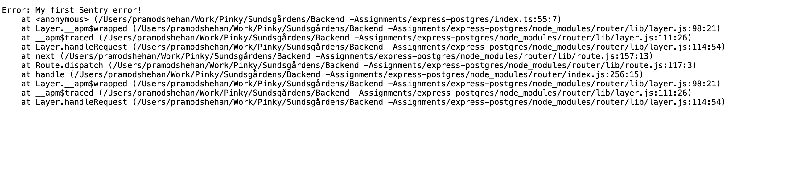
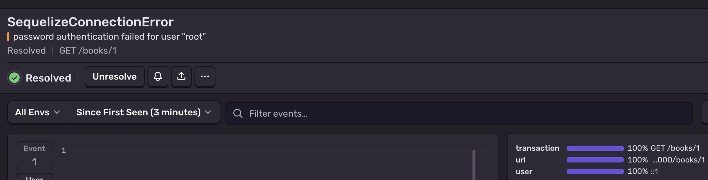
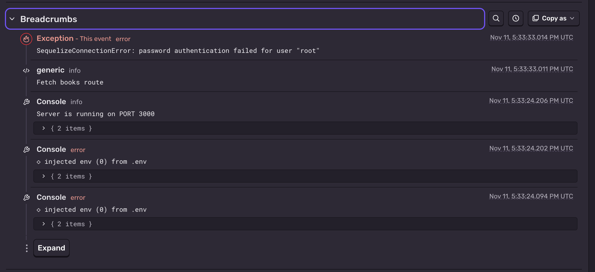
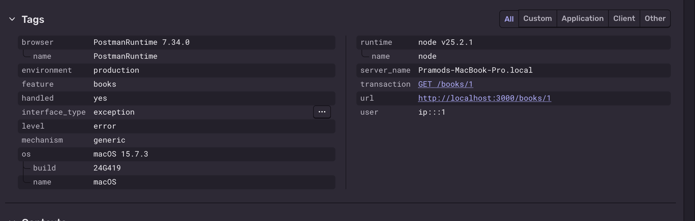
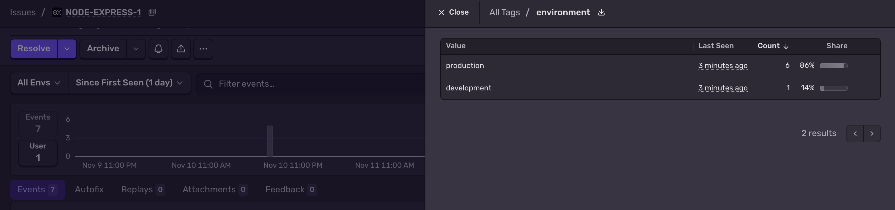

1. The video calls Sequelize a "translator". What does it translate, and from what into what?

Sequelize acts as a translator between JavaScript code and a relational database. It translates JavaScript code talk to our database without having to write complicated SQL queries directly. It make database interaction easier. 

2. What does ORM stand for? What is the "object" and what is the "relational" part?

ORM stands for Object-Relational Mapping. - This help us to work with database tables as if they were js objects.

Object: Refers to objects in programming, such as JavaScript objects that contain data and properties.
Relational: Refers to relational databases, which store data in tables with rows and columns.

3. Write the SQL that Book.findAll() runs. Then write the SQL for Book.findByPk(3).

SELECT * FROM Books;

SELECT * FROM Books WHERE id = 3;

4. In new Sequelize(...) , what does each of these do: host , port , dialect , logging ?

- host: Specifies the server address where the database is running (e.g., localhost).
- port: Specifies the port number used to connect to the database (e.g., 5432 for PostgreSQL).
- dialect: Specific type of database, such as MySQL, PostgreSQL, SQLite, or MariaDB.
- logging: Controls whether SQL queries are printed to the console. 

Why? These options tell Sequelize where the database is located, how to connect to it, which database system to use, and whether to display the SQL queries being executed.

5. What does sequelize.sync() do? What would sequelize.sync({ force: true }) do, and why
should you never use it on a database with real data?

sequelize.sync() synchronizes the database tables with the models defined in Sequelize application. It creates tables that do not already exist, but leaves existing tables unchanged by default. 

sequelize.sync({ force: true }) drops existing tables and recreates them based on the models.

Why should you never use it on a database with real data? Because it deletes existing tables and their data, which could result in losing important user information or business records.

Reference: Sequelize Official Documentation — https://sequelize.org/docs/v7/terminology/

6. Name one situation where writing plain SQL is better than using an ORM.

when performing complex queries that require high performance. Plain SQL gives the developer more direct control over the query and allows them to optimize it for the database.

# why does the loan date belong in the loans table, and not in books or members ?

The loan date belongs in the loans table because it describes the borrowing event, not the book or the member. A book can be borrowed by different members at different times, so each loan needs its own dates.

# Week 11 – Catching Bugs in Production with Sentry

1. Question: Why must instrument.js be imported before everything else?

Sentry must be initialized before everything else because it needs to load early and instrument the application libraries.  If it is imported too late, some errors or monitoring information might be missed.

2. Question 2: Why do we keep the DSN in .env instead of in the code?

This makes the application more secure and allows different environments, such as development and production, to use different DSN values. It also prevents accidentally sharing configuration values when committing code to Git.

# screenshots

the file and line number where the error was thrown - index.ts:55:7
your Node.js version - v25.2.1
your operating system -  macOS
the environment -  production

3. Question: You didn't add any extra information to this error yourself. List everything Sentry recorded anyway.

### Question 2 – Sentry automatically recorded information

- Error message
- Error type
- File and line number
- Triggered using
- Node.js version
- Operating system
- Environment
- Timestamp
- Runtime and SDK information
- Event Infor

4. Question: What happened when the handler was above the routes, and why?

Im using @sentry/node v11, where expressIntegration() automatically captures Express errors. The older Sentry.setupExpressErrorHandler(app) approach is deprecated and isn't needed when using that integration.

Exercise 4: Catch the errors you already catch

# screenshots

5. Question : Why didn't the errors inside your try/catch reach setupExpressErrorHandler by themselves?

Because the try/catch blocks handle the errors themselves.

6. Several requests failed for the same reason. Did Sentry show them as separate issues, or group them? Why is that useful?

Sentry generally groups errors that have the same underlying cause into one issue.

It is usefull because keep organized , easy to identify cause and can fix one underlying problem. 

Exercise 5: Breadcrumbs and tags

# screenshots

7.  Explain the difference between a breadcrumb and a tag in your own words. Give one
example of when each one would help your team.

A breadcrumb records what happened before an error, like a trail of actions. A tag is a label attached to an error that helps organize and filter issues.

Exercise 6: One helper instead of copy-paste

8. What does each tool give you that the other doesn't?

Sentry helps you identify, group, and investigate errors, including when they happen and which part of the application caused them.

Exercise 7: Not every error belongs in Sentry

9. Why is it a problem if Sentry fills up with errors that aren't bugs? Think about what happens when you get 200 alert emails a day.

You can get overwhelmed with alerts and start ignoring them. Important errors that indicate real bugs may get lost among all the noise, making them harder to notice and fix.

10. Name one other kind of error that shouldn't go to Sentry, and one that always should.

(not)invalid email address  and unexpected database connection failure

Exercise 8: Development or production?

# screenshots

11. Why would a team want to see development and production errors separately?

Development errors come from testing and building the application, while production errors affect real users. By separating them helps the team focus on problems effectively. 

12. What could go wrong if /debug-sentry were left open in production?

Anyone could visit the endpoint and deliberately trigger errors, filling Sentry with unnecessary alerts. This could be waste the time, and make monitoring less reliable.

Exercise 9: Be the detective

which line broke - 702
what the error message means - TypeError: Cannot read properties of null (reading 'toJSON')
which ID caused it -  Fetch item 999999

Also call the route with /items/abc . What happens? - 500Internal Server Error

13. Question: Write a short incident report in ANSWERS.md 

1. What happened
A user requested an item using the `/items/:id` route. When they entered an invalid ID, such as `/items/abc`, the application returned a 500 Internal Server Error instead of a 400 Bad Request.

2. How Sentry helped
captured the error and provided information about the failed request. The issue helped identify that Zod was throwing a `ZodError` when the ID was not a valid positive integer. 

3. The fix
I added an `instanceof ZodError` check inside the catch block. Invalid IDs now return status 400, while unexpected errors are reported to Sentry and return status 500. I also kept a check for missing items so that they return 404.

4. Prevention
I could have detected this bug sooner by testing various inputs, such as valid, missing, and invalid IDs. Consistent use of Zod validation and error handling across routes would have been beneficial. Implementing automated tests would ensure that each case returns the correct HTTP status code.