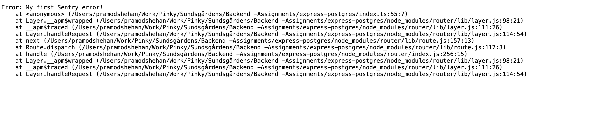
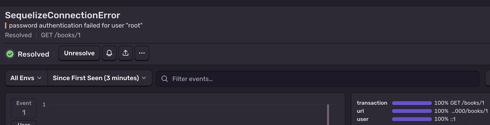
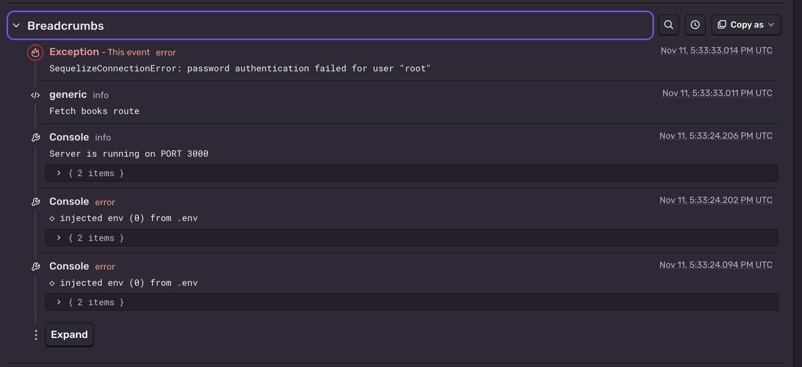
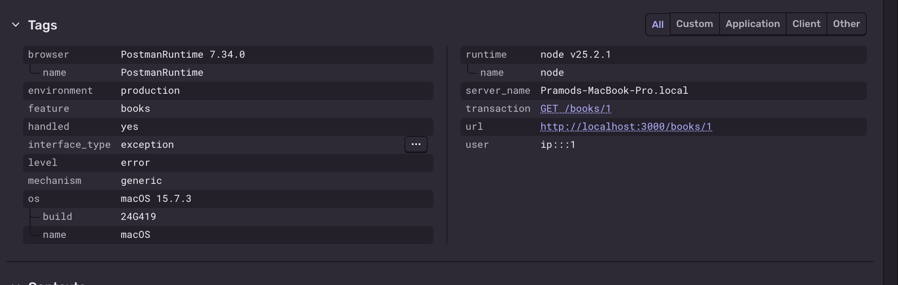
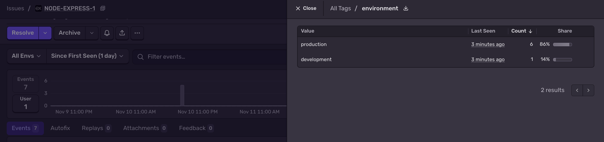
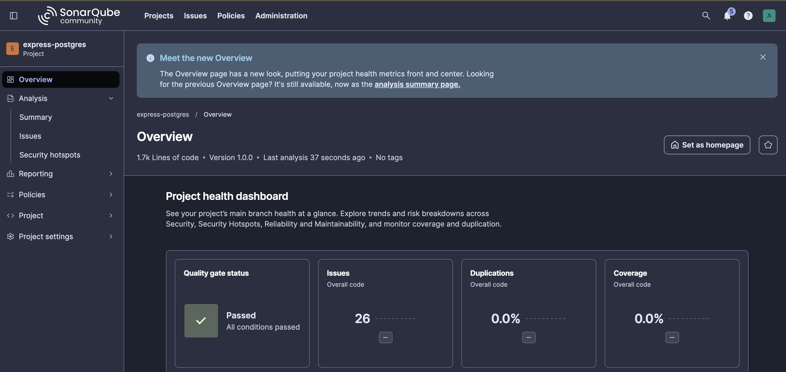
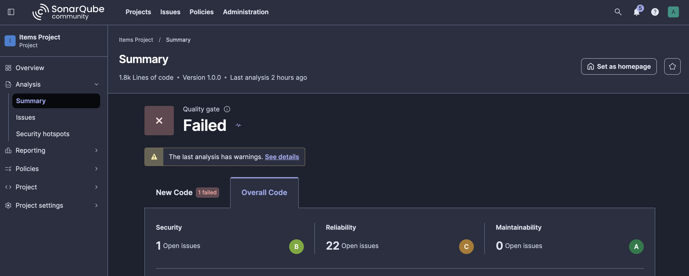
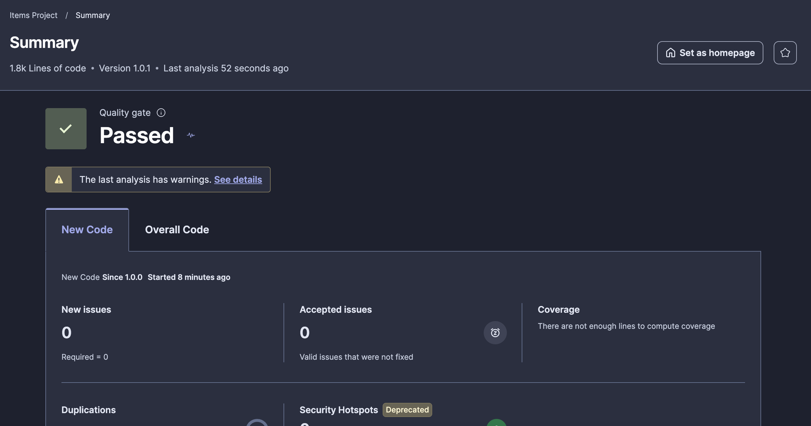

1. The video calls Sequelize a "translator". What does it translate, and from what into what?

Sequelize acts as a translator between JavaScript code and a relational database. It translates JavaScript code talk to our database without having to write complicated SQL queries directly. It make database interaction easier. 

2. What does ORM stand for? What is the "object" and what is the "relational" part?

ORM stands for Object-Relational Mapping. - This help us to work with database tables as if they were js objects.

Object: Refers to objects in programming, such as JavaScript objects that contain data and properties.
Relational: Refers to relational databases, which store data in tables with rows and columns.

3. Write the SQL that Book.findAll() runs. Then write the SQL for Book.findByPk(3).

SELECT * FROM Books;

SELECT * FROM Books WHERE id = 3;

4. In new Sequelize(...) , what does each of these do: host , port , dialect , logging ?

- host: Specifies the server address where the database is running (e.g., localhost).
- port: Specifies the port number used to connect to the database (e.g., 5432 for PostgreSQL).
- dialect: Specific type of database, such as MySQL, PostgreSQL, SQLite, or MariaDB.
- logging: Controls whether SQL queries are printed to the console. 

Why? These options tell Sequelize where the database is located, how to connect to it, which database system to use, and whether to display the SQL queries being executed.

5. What does sequelize.sync() do? What would sequelize.sync({ force: true }) do, and why
should you never use it on a database with real data?

sequelize.sync() synchronizes the database tables with the models defined in Sequelize application. It creates tables that do not already exist, but leaves existing tables unchanged by default. 

sequelize.sync({ force: true }) drops existing tables and recreates them based on the models.

Why should you never use it on a database with real data? Because it deletes existing tables and their data, which could result in losing important user information or business records.

Reference: Sequelize Official Documentation — https://sequelize.org/docs/v7/terminology/

6. Name one situation where writing plain SQL is better than using an ORM.

when performing complex queries that require high performance. Plain SQL gives the developer more direct control over the query and allows them to optimize it for the database.

# why does the loan date belong in the loans table, and not in books or members ?

The loan date belongs in the loans table because it describes the borrowing event, not the book or the member. A book can be borrowed by different members at different times, so each loan needs its own dates.

# Week 11 – Catching Bugs in Production with Sentry

1. Question: Why must instrument.js be imported before everything else?

Sentry must be initialized before everything else because it needs to load early and instrument the application libraries.  If it is imported too late, some errors or monitoring information might be missed.

2. Question 2: Why do we keep the DSN in .env instead of in the code?

This makes the application more secure and allows different environments, such as development and production, to use different DSN values. It also prevents accidentally sharing configuration values when committing code to Git.

# screenshots

the file and line number where the error was thrown - index.ts:55:7
your Node.js version - v25.2.1
your operating system -  macOS
the environment -  production

3. Question: You didn't add any extra information to this error yourself. List everything Sentry recorded anyway.

### Question 2 – Sentry automatically recorded information

- Error message
- Error type
- File and line number
- Triggered using
- Node.js version
- Operating system
- Environment
- Timestamp
- Runtime and SDK information
- Event Infor

4. Question: What happened when the handler was above the routes, and why?

Im using @sentry/node v11, where expressIntegration() automatically captures Express errors. The older Sentry.setupExpressErrorHandler(app) approach is deprecated and isn't needed when using that integration.

Exercise 4: Catch the errors you already catch

# screenshots

5. Question : Why didn't the errors inside your try/catch reach setupExpressErrorHandler by themselves?

Because the try/catch blocks handle the errors themselves.

6. Several requests failed for the same reason. Did Sentry show them as separate issues, or group them? Why is that useful?

Sentry generally groups errors that have the same underlying cause into one issue.

It is usefull because keep organized , easy to identify cause and can fix one underlying problem. 

Exercise 5: Breadcrumbs and tags

# screenshots

7.  Explain the difference between a breadcrumb and a tag in your own words. Give one
example of when each one would help your team.

A breadcrumb records what happened before an error, like a trail of actions. A tag is a label attached to an error that helps organize and filter issues.

Exercise 6: One helper instead of copy-paste

8. What does each tool give you that the other doesn't?

Sentry helps you identify, group, and investigate errors, including when they happen and which part of the application caused them.

Exercise 7: Not every error belongs in Sentry

9. Why is it a problem if Sentry fills up with errors that aren't bugs? Think about what happens when you get 200 alert emails a day.

You can get overwhelmed with alerts and start ignoring them. Important errors that indicate real bugs may get lost among all the noise, making them harder to notice and fix.

10. Name one other kind of error that shouldn't go to Sentry, and one that always should.

(not)invalid email address  and unexpected database connection failure

Exercise 8: Development or production?

# screenshots

11. Why would a team want to see development and production errors separately?

Development errors come from testing and building the application, while production errors affect real users. By separating them helps the team focus on problems effectively. 

12. What could go wrong if /debug-sentry were left open in production?

Anyone could visit the endpoint and deliberately trigger errors, filling Sentry with unnecessary alerts. This could be waste the time, and make monitoring less reliable.

Exercise 9: Be the detective

which line broke - 702
what the error message means - TypeError: Cannot read properties of null (reading 'toJSON')
which ID caused it -  Fetch item 999999

Also call the route with /items/abc . What happens? - 500Internal Server Error

13. Question: Write a short incident report in ANSWERS.md 

1. What happened
A user requested an item using the `/items/:id` route. When they entered an invalid ID, such as `/items/abc`, the application returned a 500 Internal Server Error instead of a 400 Bad Request.

2. How Sentry helped
captured the error and provided information about the failed request. The issue helped identify that Zod was throwing a `ZodError` when the ID was not a valid positive integer. 

3. The fix
I added an `instanceof ZodError` check inside the catch block. Invalid IDs now return status 400, while unexpected errors are reported to Sentry and return status 500. I also kept a check for missing items so that they return 404.

4. Prevention
I could have detected this bug sooner by testing various inputs, such as valid, missing, and invalid IDs. Consistent use of Zod validation and error handling across routes would have been beneficial. Implementing automated tests would ensure that each case returns the correct HTTP status code.

## Week 11 – Code Quality with SonarQube

* Exercise 1: SonarQube in Docker

1. Question- What does docker ps show you? Which columns tell you that SonarQube is running, and on which port?

0b4fe69bbca5   sonarqube        "/opt/sonarqube/dock…"   18 minutes ago   Up 18 minutes   0.0.0.0:9000->9000/tcp          my-sonarqube
5cfd45837a9c   dpage/pgadmin4   "/entrypoint.sh"         4 hours ago      Up 4 hours      443/tcp, 0.0.0.0:8080->80/tcp   my_database12
8380fabc5801   postgres         "docker-entrypoint.s…"   4 hours ago      Up 4 hours      0.0.0.0:5433->5432/tcp          my_database11

first one identifies the container as my-sonarqube and The PORTS column shows that port 9000

2. Question 2: Why run SonarQube in Docker instead of installing it directly on your computer?

Running SonarQube in Docker makes installation and configuration easier because Docker manages the application and its dependencies in an isolated container.

* Exercise 2: Your first scan

# screenshots

3. Question: Did your project pass or fail the quality gate? How many issues did SonarQube find?

Passed. 26 issues 

* Exercise 3: Read before you fix

* Issue 1

Rule name: Web:InputWithoutLabelCheck

File: public/index.html

Line: 177-181

What is wrong - The search input field does not have an associated label.

What would compliant code look like? - for attribute of the <label> and connecting it to the input field using Id 

Do I agree? Why? - YES. Adding a proper label helps and increase understand. 

* Issue 2 

Rule name: javascript

File: public/script.js

Line: 371

What is wrong - The function loadBooks(currentPage) appears to return a Promise, but the code does not wait for it to finish or handle a possible rejection.

What would compliant code look like? - 
one way it shows;

async function sendMetrics(payload) {
  await fetch('/metrics', { method: 'POST', body: payload });
}

Do I agree? Why? - Yes, I agree because asynchronous operations can fail.

* Issue 3 

Rule name: typescript

File: index.ts

Line: 48-56

What is wrong - Express can disclose information about the technology used by the application through HTTP response headers.

What would compliant code look like? - 
I can use this;

let express = require('express');

let example = express();
example.disable("x-powered-by");

Do I agree? Why? - Yes, It is a simple security improvement that reduces unnecessary information disclosure.

4. Question: Depending on the version, SonarQube groups issues either by the quality they affect (Security, Reliability, Maintainability) or by type (Vulnerability, Bug, Code Smell). Explain each of the three groups your SonarQube uses, with an example.

My SonarQube uses the categories Security, Reliability and Maintainability.

Security: Security issues are problems that could make an application vulnerable to attacks or unauthorized access. 

Reliability: Reliability issues are problems in the code that could cause errors or make the application behave incorrectly. 

Maintainability: Maintainability issues are problems that make code difficult to understand, modify or maintain. 

5. Question: SonarQube, your tests and Sentry all help you find problems. What does each one find that the others can't?

SonarQube finds potential problems in the source code, automated tests check whether the application works correctly, and Sentry detects errors that occur while the application is running. They find different types of problems.

* Exercise 4: Get the token out of your code

6. Question: Your package.json goes to GitHub. What could someone do with your SonarQube token if they found it there? What about a database password or a Sentry DSN?

If someone found my SonarQube token on GitHub, they could potentially use it to authenticate with my SonarQube server and submit unauthorized code analyses, depending on the token's permissions.

If someone found my database password, they could potentially connect to my database and read, modify or delete data, depending on the database user's permissions.

In the context of security, exposure of a SonarQube token on GitHub could allow unauthorized code analyses depending on its permissions. 

A database password could enable access to read, modify, or delete data, contingent on user permissions. 

Sentry DSN, intended for client-side use, could permit the submission of false events to a Sentry project but typically does not grant administrative access.

7. Question: Why is it better to put settings like the project key in long command?
sonar-project.properties than in a

Utilizing a properties file for settings such as the project key enhances clarity and maintainability of the scanner command, centralizes configuration, and minimizes errors. It allows for consistent reuse during SonarQube scans and can be safely committed to GitHub since it contains non-sensitive project information.

* Exercise 5: Scan only your own code

8. Look at the Code tab in SonarQube. Which folders and files were scanned?

I have already added sonar.exclusions=node_modules/**,coverage/**,.git/** to the sonar-project.properties when im doing exercise 4. So right now I can see;

models
Public
src 
db.ts
eslint.config
index.ts
instrument.ts
sequeilze.ts

9. Question: What changed in the numbers, and why? Why is it a problem when a tool reports issues in code you didn't write?

Usually when after adding exclusions and configuring, the number of lines of code should change. The number of issues also changed.

The numbers changed because SonarQube now focuses on my own application code instead of analysing unnecessary files. 

* Exercise 6: Fix, test, repeat

Rule- File - What I changed- Tests still green? 

Promises must be awaited, end with a call to .catch, end with a call to .then with a  - rejection handler or be explicitly marked as ignored with the `void` operator.

script.js

used async and await 

Yes

I have done three isuues all three were same. 

10. Question 1: Why run your tests after every fix, even when the change looks small?

It help to check that the application still behaves correctly after each modification.

11. Question 2: Choose one of your fixes. Is the code easier to read now? Explain why or why not.

Yes using async/await makes the asynchronous operation look more like normal code.

* Exercise 8: Make the quality gate fail, then pass

# screenshots - Failed

# screenshots - Passed

12. Question 1: Why does the Quality Gate focus on new code instead of all the code in the project?

Because developers can make sure that new changes meet quality standards without having to fix every existing problem immediately.

13. Question 2: In a team, what could you use a failing Quality Gate for?

It can be used to prevent bad code from being merged into the main branch.

* Exercise 9: Security review and your final report

## Security Review

SonarQube reported no Security Hotspots to review in the latest analysis. Therefore, there were no hotspots to mark as Safe or fix.

No hotspot could be marked as Accept or False Positive because no security hotspots were detected.

## 1. Quality Report

| Metric | First scan | Final scan |
|---|---|---|
| Quality gate | Failed | Passed |
| Lines of code | Not recorded | 1750 |
| Issues | 26 | 23 |
| Security hotspots to review | No | No |
| Coverage | 0.0% | 0.0% |

The first scan's lines of code were not recorded. The final scan reported 1,750 lines of code.

## 2. What changed the most, and what caused it?

The number of issues and security warnings changed after I reviewed and fixed problematic code. I removed hard-coded credentials, improved the code and added unit tests. This helped improve the overall code quality and security.

## 3. Which fix are you proudest of, and why?

I am proudest of removing hard-coded passwords and API keys from the source code. To have more secure because sensitive information is no longer directly exposed in the code.

## 4. What's left, and would you fix it next, or leave it? Why?

Some existing issues may still remain in the project. I would prioritize fixing serious security vulnerabilities and bugs first. Minor issues with little impact could be do later. 

14. Question: You marked an issue as Accept or False positive. What could go wrong if a team does that too often?

Real problems might be ignored and bugs could remain in the code. It can also make the team take code quality less seriously because the warnings are ignored. 

15. Question: Over the last weeks you used tests, Zod, Sentry and SonarQube. If you could only keep two of them on a real project, which would you choose, and why?

I would choose tests and Sentry. Tests help find bugs while Sentry helps detect and investigate errors.

